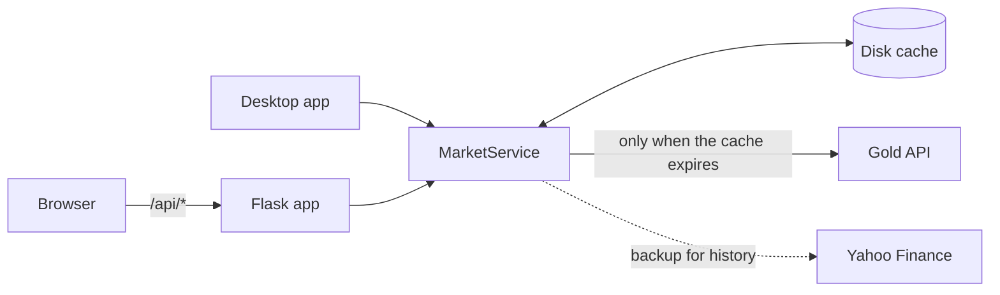

# Gold/Silver Ratio Tracker

A web dashboard for the gold/silver ratio: spot prices in USD, CAD, EUR and INR with a currency picker, a purchase calculator, a year of ratio history, and a small assistant that answers questions about the current numbers.

Live prices come from [Gold API](https://gold-api.com), which is free and needs no key. Responses are cached on disk, so the number of provider requests stays the same however many people visit.

> For information only. This is not financial advice.

## Quick start

You need Python 3.11 or later.

**Windows:** run `scripts\start-windows.bat`. It sets everything up and opens the site.

**macOS, Linux or manual setup:**

```bash
python -m venv .venv
source .venv/bin/activate        # Windows: .venv\Scripts\activate
pip install -r requirements.txt
cp .env.example .env
python -m goldsilver
```

Open <http://127.0.0.1:5000>.

The assistant is also available as a desktop app with `python -m goldsilver.desktop`.

## Configuration

Settings are read from the environment or `.env`. See [.env.example](.env.example).

| Variable | Default | Purpose |
| --- | --- | --- |
| `GOLD_API_KEY` | none | Optional free key. Makes the history chart use Gold API spot prices. |
| `PRICE_CACHE_SECONDS` | `60` | How long to reuse the latest prices. |
| `HISTORY_CACHE_SECONDS` | `86400` | How long to reuse the ratio history. |
| `HOST` | `127.0.0.1` | Address to listen on. |
| `PORT` | `5000` | Port to listen on. |
| `CACHE_PATH` | `instance/market-cache.json` | Location of the on-disk cache. |

Gold API updates about every 30 seconds and bans clients that send bursts of requests, so avoid setting `PRICE_CACHE_SECONDS` very low.

## How it works



If the provider fails, the site shows the last good data, labelled with its age, and waits before retrying. It never substitutes estimated prices.

The history chart uses Gold API's daily averages when `GOLD_API_KEY` is set. Without a key, or if that request fails, it uses COMEX futures closes from Yahoo Finance's unofficial endpoint. If both fail, it charts one reading a day recorded by the app.

| Endpoint | Description |
| --- | --- |
| `GET /api/prices` | Latest ratio, and prices per ounce and gram in each currency |
| `GET /api/history` | Daily gold, silver and ratio values for up to 365 days |
| `POST /api/chat` | Answers `{"question": "..."}` with a structured reply |
| `GET /api/health` | Liveness check |

Data routes return `503` with an error code when no data is available.

## Deployment

The application needs a server process, so static-only hosts such as GitHub Pages will not work. Any platform that runs a container or a Python process will.

```bash
docker build -t gold-silver-ratio .
docker run -p 8000:8000 --env-file .env -e HOST=0.0.0.0 -e PORT=8000 -v gold-silver-data:/data gold-silver-ratio
```

Keep the `/data` volume between deployments, so each one does not spend API quota refilling the cache. See [SECURITY.md](SECURITY.md) for the deployment checklist.

## Project layout

```text
goldsilver/
  config.py       Settings from the environment
  market.py       Provider client, cache and price conversions
  chatbot.py      Rule-based assistant
  web.py          Flask routes and security headers
  desktop.py      Desktop chat client
  templates/      Page markup
  static/         Styles and browser modules
tests/            Test suite, with no network or API key needed
scripts/          Windows launcher
```

## Development

See [CONTRIBUTING.md](CONTRIBUTING.md).

```bash
pip install -r requirements-dev.txt
pytest
ruff check .
```

## License

[MIT](LICENSE)
